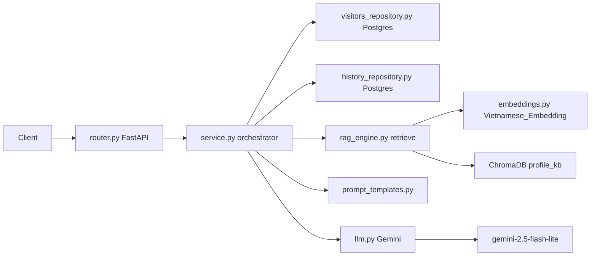
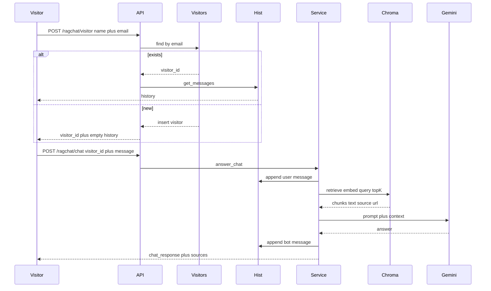

Mô tả project: BE của website profile cá nhân. Visitor hỏi về chủ nhân web; BE trả lời bằng LLM RAG (không login / JWT). Identity = tên + email. Stack: Python, FastAPI, Postgres, ChromaDB, Gemini.

---

## 0. Setup & chạy project

Thư mục gốc repo `chatbot-profile`: `.env`, `requirements.txt`, `docker-compose.yml`, `alembic/`. App load `.env` từ đây, **không** từ `src/`.

### Python

Khuyến nghị **Python 3.11** (Conda env `chatbot-profile`).

| Nơi ghi | Version |
| --- | --- |
| README | 3.10+, khuyến nghị 3.11 |
| `requirements.txt` | 3.11.x |
| Dockerfile | `FROM python:3.11-slim` |

```bash
conda create -n chatbot-profile python=3.11 -y
conda activate chatbot-profile
```

### Dependencies

Từ thư mục gốc:

```bash
pip install -r requirements.txt
```

GPU (CUDA 12.4 / Torch cu124), optional:

```bash
pip install -r requirements.txt --extra-index-url https://download.pytorch.org/whl/cu124
```

`requirements.txt` có `--extra-index-url` cho PyTorch. Mặc định chạy **CPU**. Không cần Poppler.

### `.env`

```bash
cp .env.example .env
```

Biến tối thiểu:

```env
DATABASE_URL='postgresql://postgres:a@127.0.0.1:54322/chatbot_profile'
GEMINI_API_KEY="your-gemini-key"
GEMINI_API_KEYS="your-gemini-key"
SECRET_KEY="your-secret-key"
CORS_ORIGINS="http://localhost:3000"
```

- `SECRET_KEY` = giá trị header `X-Secret-Key` (`/ragchat/clear`, `/ragchat/reingest`).
- Không login → không `REFRESH_SECRET_KEY`.
- `CORS_ORIGINS`: origin FE, cách nhau bằng dấu phẩy.

### PostgreSQL

Chạy **Docker**, không cài Postgres native.

```bash
docker compose -f docker-compose.yml up -d
```

Service `postgres_db`:

| | |
| --- | --- |
| Image | `postgres:16` |
| User / password / DB | `postgres` / `a` / `chatbot_profile` |
| Port host | `54322` (tránh đụng Postgres khác trên `5432`) |

### Migration

Postgres đang chạy, từ thư mục gốc:

```bash
conda activate chatbot-profile
alembic upgrade head
```

Alembic lấy `DATABASE_URL` từ `.env` (`alembic/env.py` ghi đè `alembic.ini`).

Bảng: `ragchat_visitors`, `ragchat_conversations` (`visitor_id` FK, **1 visitor = 1 conversation**), `ragchat_messages`.

### Start FastAPI

Từ thư mục gốc repo:

```powershell
conda activate chatbot-profile
python src/main.py
```

Linux / WSL: cùng lệnh `python src/main.py`.

Port **8000**. `main.py` tự gắn `src/` vào path (không cần `PYTHONPATH`). Log lúc start: URL Swagger/health, CORS, DB (password ẩn), số Gemini key, Chroma, file markdown; mỗi request log method/path/status/thời gian.

Lần đầu: `ensure_index()` (collection Chroma `profile_kb` trong `chroma_storage/`).

Cách cũ (vẫn dùng được):

```powershell
$env:PYTHONPATH="src"
python -m uvicorn src.main:app --host 0.0.0.0 --port 8000 --reload
```

### Swagger

- Swagger UI: http://localhost:8000/docs
- ReDoc: http://localhost:8000/redoc
- OpenAPI JSON: http://localhost:8000/openapi.json

`FastAPI(...)` không đổi `docs_url`.

### Test

Chưa có suite. Khi thêm: `pytest` trong `requirements.txt`.

```powershell
conda activate chatbot-profile
$env:PYTHONPATH="src"
python -m pytest
```

Linux: `export PYTHONPATH=src` rồi `python -m pytest`.

---

## 1. Bức tranh tổng thể



RAG = embed câu hỏi → top-K chunk trong Chroma → nhét chunk + history vào prompt → Gemini trả lời grounded trên **profile chủ nhân web**.

Identity: email (trim + lowercase) là khóa duy nhất. `POST /ragchat/visitor` lookup/insert, trả `visitor_id` + history. Chat/history dùng `visitor_id`. Không Bearer, không `session_id`. Không mật khẩu — ai biết email có thể lấy history.

Chỉ một module chat: `src/ragchat/`. Không có router chatbot cũ, không scrape ToS.

---

## 2. Luồng API

### `POST /ragchat/visitor`

Body:

```json
{ "name": "An", "email": "an@example.com" }
```

`name` rỗng / `email` sai format → 400. Chỉ validate format, không verify hộp thư.

Luồng `service.identify_visitor`:

1. Normalize email (trim + lowercase).
2. `visitors_repository.get_by_email(email)`.
3. **Đã có:** cập nhật `name` (nếu đổi) + `last_seen_at`; `is_new=false`; lấy **đúng một** conversation theo `visitor_id`; trả history.
4. **Chưa có:** insert visitor + conversation rỗng; `is_new=true`; `messages=[]`.
5. Return:

```json
{
  "visitor_id": "uuid",
  "name": "An",
  "email": "an@example.com",
  "is_new": true,
  "messages": [
    { "sender": "user|chatbot", "content": "...", "sources": [], "created_at": "..." }
  ]
}
```

FE lưu `visitor_id` (localStorage) rồi gửi lại mỗi request.

### `POST /ragchat/chat`

Body: `{ "visitor_id": "uuid", "message": "..." }`. Message rỗng → 400. `visitor_id` không tồn tại → **404**.

Luồng `service.answer_chat`:

1. `append_message(..., visitor_id=..., sender="user")`.
2. `rag_engine.retrieve(chat_message, top_k=5)`.
3. Ghép `context` từ `chunk["text"]`.
4. History tối đa 10 tin → `RagPrompt.build(...)`.
5. `generate_answer(prompt)` — Gemini.
6. Dedup sources `(source, url)`.
7. `append_message(..., sender="chatbot", sources=...)`.
8. Return `{ "chat_response": "...", "sources": [{ "source": "...", "url": "..." }] }`.

Không filter theo role, không dùng `node.score`, không short-circuit câu ngoài phạm vi (LLM từ chối theo prompt).

### `GET /ragchat/history?visitor_id=`

Query bắt buộc `visitor_id`. Thiếu → 400. Không có visitor → 404.

Có thể prepend `chatbot_first_message` (constant trong `constants.py`) khi FE cần câu chào. Response: `{ "messages": [ ... ] }` cùng shape như trên.

### `POST /ragchat/clear` và `POST /ragchat/reingest`

Header `X-Secret-Key` == `SECRET_KEY`. Sai/thiếu → 401.

- `clear`: chỉ xóa in-memory cache (retrieval/LLM). **Không** xóa visitor hay chat Postgres.
- `reingest`: rebuild collection từ markdown local (không fetch URL).

### Startup

`main.py` `on_startup` → `rag_engine.ensure_index()`: collection `profile_kb` khớp `embed_model` + `chunking` + `docs_hash` thì giữ; không thì ingest lại từ file local.

---

## 3. Catalog function

| File | Function | Nhiệm vụ |
| --- | --- | --- |
| `src/config.py` | settings | Đọc `.env` gốc: DB, Gemini, SECRET_KEY, CORS. |
| `src/main.py` | app / on_startup | FastAPI, CORS, mount ragchat router, `ensure_index`. |
| `src/ragchat/router.py` | `_require_visitor_id` | Lấy `visitor_id` (body POST, query GET); thiếu → 400. |
| | `identify_visitor` | `POST /ragchat/visitor`. |
| | `chat` / `history` / `clear` / `reingest` | HTTP boundary. |
| `src/ragchat/service.py` | `identify_visitor` | Normalize email, lookup/insert, đọc messages. |
| | `answer_chat` | RAG orchestrator; identity = `visitor_id`. |
| | `get_history` | Messages theo `visitor_id`, optional welcome. |
| | `clear_all` | Xóa cache RAM. |
| `src/ragchat/visitors_repository.py` | `get_by_email`, `get_by_id`, `create`, `touch` | Bảng `ragchat_visitors`. |
| `src/ragchat/history_repository.py` | `get_or_create_conversation`, `append_message`, `get_messages` | 1 visitor = 1 conversation; trim 20 tin; **không TTL / không sweep**. |
| `src/ragchat/rag_engine.py` | `ensure_index` / `reingest` / `retrieve` | Chroma `profile_kb`, ingest local markdown. |
| `src/ragchat/embeddings.py` | `ProfileHuggingFaceEmbedding` | `AITeamVN/Vietnamese_Embedding`, L2-normalize. |
| `src/ragchat/llm.py` | `generate_answer` | Gemini key rotation, cache, fallback tiếng Việt. |
| `src/ragchat/doc_loader.py` | `load_text` | Đọc markdown local (không scrape URL). |
| `src/ragchat/cache.py` | `TTLCache`, `normalize_query` | Retrieval / LLM TTL 5 phút, per-worker. |
| `src/ragchat/prompt_templates.py` | `RagPrompt.build` | Grounded **profile chủ nhân**; không bịa; cùng ngôn ngữ user; chào hỏi ngắn. |

Schema:

```text
ragchat_visitors
  id            UUID PK
  name          TEXT NOT NULL
  email         TEXT NOT NULL UNIQUE   -- lowercase
  created_at    TIMESTAMPTZ
  last_seen_at  TIMESTAMPTZ

ragchat_conversations
  id            UUID PK
  visitor_id    UUID UNIQUE FK         -- 1-1
  created_at    TIMESTAMPTZ

ragchat_messages
  id, conversation_id FK, sender, content, sources JSONB, created_at
```

Corpus: markdown local trong `data/` (hoặc `src/ragchat/docs/`), nguồn `profile` (+ `faq` nếu cần). Collection: `profile_kb`. Path: `chroma_storage/` (không nằm trong `static/`).

---

## 4. LLM RAG

**Retriever:** embed câu hỏi bằng cùng model đã embed chunk → Chroma top-K = 5 → LlamaIndex `VectorStoreIndex.as_retriever`.

**Generator:** Gemini `gemini-2.5-flash-lite` không search web, không đọc Chroma. Chỉ thấy prompt: today + context chunks + history + question + rules. Trả lời grounded trên profile; từ chối unsafe; chào hỏi ngắn; không bịa sự kiện/số liệu.

Ingest (khi docs đổi) ≠ query (mỗi tin): ingest embed nhiều chunk; query embed 1 câu + ANN + 1 lần generate.



---

## 5. ChromaDB

- PersistentClient tại `chroma_storage/`.
- Một collection `profile_kb`. Metadata: `embed_model`, `chunking=semantic`, `docs_hash`.
- Mỗi chunk: embedding 1024-dim (`AITeamVN/Vietnamese_Embedding`), metadata `source` + `url` (url có thể rỗng với file local).
- Chunking: `SemanticSplitterNodeParser` rồi `SentenceSplitter(1024, overlap=50)`.
- Query: L2-normalized (cosine-equivalent). `retrieve()` **không** trả score.
- Rebuild: `delete_collection` → `create_collection` → `VectorStoreIndex.from_documents`.

---

## 6. Phạm vi build (greenfield)

Scaffold repo này theo README, **không** copy sharecv-be.

- `src/main.py`, `src/config.py`, `src/ragchat/*`, `alembic/`, `docker-compose.yml`, `.env.example`, `requirements.txt`, `data/` markdown profile.
- Visitor + history như mục 2–3.
- RAG/Chroma như mục 4–5; corpus chỉ profile local.
- Không JWT, không `session_id`, không module chatbot cũ, không scrape ToS, không Typesense/OAuth/VNPay.
- Không commit trừ khi bạn yêu cầu.
