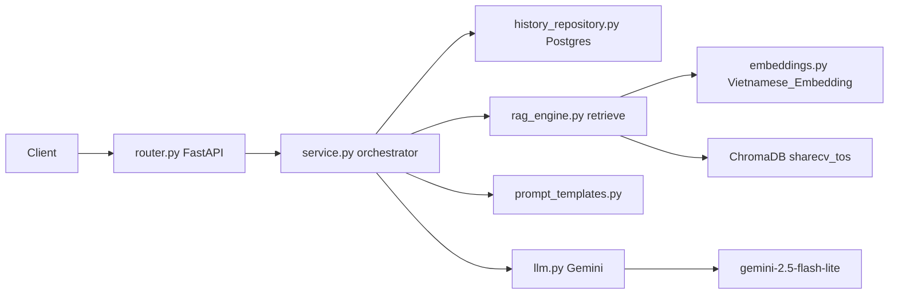
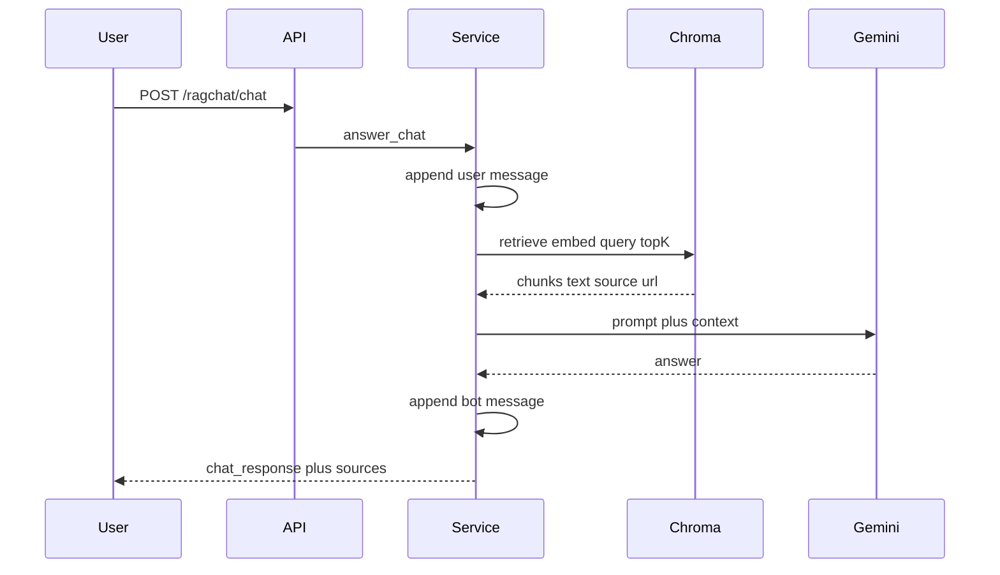

# Tài liệu cấu trúc RagChat (hệ thống hiện tại)

**Deliverable:** một file markdown tiếng Việt, ví dụ `[docs/ragchat-architecture.md](docs/ragchat-architecture.md)` (hoặc `[src/ragchat/ARCHITECTURE.md](src/ragchat/ARCHITECTURE.md)` nếu muốn nằm cạnh code). Không sửa logic runtime.

Phạm vi: module **ragchat** (`POST /ragchat/`*) — chatbot RAG + ChromaDB đang dùng. Module cũ `[src/chatbot/](src/chatbot/)` (nhồi cả file knowledge base vào prompt, không có vector DB) chỉ được nhắc ngắn để tránh nhầm.

Hai chatbot đang sống song song trong `[src/main.py](src/main.py)`: `chatbot_router` và `ragchat_router`. Startup gọi `rag_engine.ensure_index()`.

---

## 1. Bức tranh tổng thể

RAG ở đây = **Retrieval-Augmented Generation**: không nhồi cả corpus vào LLM. Query được embed → tìm top-K chunk gần nhất trong ChromaDB → nhét chunk đó + lịch sử chat vào prompt → Gemini trả lời grounded trên context.

---

## 2. Luồng API (sẽ viết chi tiết trong doc)

### `POST /ragchat/chat`

Auth: Bearer token **tùy chọn**. Thiếu token thì bắt buộc `session_id`. Message rỗng → 400.

Luồng thực tế trong `[service.answer_chat](src/ragchat/service.py)`:

1. `append_message(..., sender="user")` — lưu câu hỏi Postgres.
2. `rag_engine.retrieve(chat_message, top_k=5)` — embed query, search Chroma, trả chunks.
3. Ghép `context` từ `chunk["text"]`.
4. Lấy history (tối đa 10 tin) → `RagPrompt.build(...)`.
5. `generate_answer(prompt)` — Gemini.
6. Dedup sources `(source, url)`.
7. `append_message(..., sender="chatbot", sources=...)`.
8. Return `{ chat_response, sources }`.

**Chưa có trong code hiện tại** (sẽ ghi rõ là *không làm*, tránh nhầm với `[ROUTER_RETRIEVER_DESIGN.md](src/ragchat/ROUTER_RETRIEVER_DESIGN.md)`): không filter theo role, không dùng `node.score`, không short-circuit câu hỏi ngoài phạm vi.

### `GET /ragchat/history`

Cùng identity (user_id hoặc session_id). Có thể prepend `chatbot_first_message` khi FE cần câu chào.

### `POST /ragchat/clear` và `POST /ragchat/reingest`

Cần header `X-Secret-Key`. Clear chỉ xóa in-memory cache (history sweep đang comment). Reingest fetch URL ToS (trừ `local_only`) rồi rebuild collection.

### Startup

`main.py` `on_startup` → `rag_engine.ensure_index()`: nếu collection `sharecv_tos` khớp `embed_model` + `chunking` + `docs_hash` thì giữ nguyên; không thì ingest lại từ file local.

---

## 3. Catalog function (sẽ liệt kê nhiệm vụ từng hàm)

Tài liệu sẽ có bảng/section theo file:

| File                                                         | Function                                                                                     | Nhiệm vụ                                                                                 |
| ------------------------------------------------------------ | -------------------------------------------------------------------------------------------- | ---------------------------------------------------------------------------------------- |
| `[router.py](src/ragchat/router.py)`                         | `_optional_user_id`                                                                          | Parse Bearer; trả `user.id` hoặc None (nuốt lỗi auth). **Không** truyền role.            |
|                                                              | `chat` / `history` / `clear` / `reingest`                                                    | HTTP boundary, validate, ủy thác service/engine.                                         |
| `[service.py](src/ragchat/service.py)`                       | `answer_chat`                                                                                | Orchestrator RAG: history → retrieve → prompt → LLM → sources.                           |
|                                                              | `get_history`                                                                                | Đọc messages, optional welcome.                                                          |
|                                                              | `clear_all`                                                                                  | Xóa retrieval/LLM cache.                                                                 |
| `[rag_engine.py](src/ragchat/rag_engine.py)`                 | `_get_chroma_client` / `_get_embed_model`                                                    | Singleton PersistentClient + SentenceTransformer.                                        |
|                                                              | `_build_documents` / `_documents_hash`                                                       | Load markdown + fingerprint corpus.                                                      |
|                                                              | `_ingest`                                                                                    | Xóa collection cũ, semantic+sentence split, embed, ghi Chroma.                           |
|                                                              | `ensure_index` / `reingest` / `retrieve`                                                     | Boot, rebuild từ URL, query top-K (+ cache).                                             |
| `[embeddings.py](src/ragchat/embeddings.py)`                 | `ShareCVHuggingFaceEmbedding`                                                                | `AITeamVN/Vietnamese_Embedding`, L2-normalize (cosine ≈ L2 trên Chroma).                 |
| `[llm.py](src/ragchat/llm.py)`                               | `generate_answer`                                                                            | Gemini key rotation, cache, fallback tiếng Việt.                                         |
| `[doc_loader.py](src/ragchat/doc_loader.py)`                 | `load_text` / `refresh_from_url` / `html_to_text`                                            | Local markdown vs scrape ToS.                                                            |
| `[history_repository.py](src/ragchat/history_repository.py)` | `get_or_create_conversation`, `append_message`, `get_messages`, `sweep_expired`, `clear_all` | Postgres `ragchat_conversations` / `ragchat_messages`; trim 20; TTL 1h (sweep đang tắt). |
| `[cache.py](src/ragchat/cache.py)`                           | `TTLCache`, `normalize_query`                                                                | Retrieval TTL 5 phút / LLM TTL 5 phút, per-worker.                                       |
| `[prompt_templates.py](src/ragchat/prompt_templates.py)`     | `RagPrompt.build`                                                                            | Grounded ToS + rules (không bịa, cùng ngôn ngữ user, chào hỏi).                          |

Corpus `[TOS_DOCUMENTS](src/ragchat/constants.py)`: `collaborator`, `recruiter` (có URL), `profile`, `proposal`, `contractor`, `faq` (`local_only`). Collection name: `sharecv_tos`. Path: `chroma_storage/` (không nằm trong `static/`).

---

## 4. LLM RAG — nhiệm vụ và cách chạy

Tách 2 vai trò (thường bị gọi chung là “RAG”):

**Retriever (không phải LLM sinh text):**

- Embed câu hỏi bằng cùng model đã embed chunk.
- Chroma trả về các vector gần nhất (`TOP_K = 5`).
- LlamaIndex `VectorStoreIndex.as_retriever` bọc Chroma.

**Generator (LLM):**

- Gemini `gemini-2.5-flash-lite` **không** search web, **không** đọc Chroma trực tiếp.
- Chỉ thấy prompt: today + context chunks + history + question + rules.
- Nhiệm vụ: trả lời grounded, từ chối unsafe, chào hỏi ngắn, không bịa số liệu ToS.

Ingest (một lần / khi docs đổi) khác query (mỗi tin nhắn): ingest tốn embed nhiều chunk; query chỉ embed 1 câu + ANN search + 1 lần generate.

---

## 5. ChromaDB — nhiệm vụ và cách chạy

- **PersistentClient** tại `chroma_storage/` (SQLite metadata + HNSW binary).
- Một collection `sharecv_tos`. Metadata collection stamp: `embed_model`, `chunking=semantic`, `docs_hash`.
- Mỗi chunk: embedding 1024-dim (BGE-M3 / Vietnamese_Embedding), metadata `source` + `url`.
- Chunking: `SemanticSplitterNodeParser` (cắt theo topic shift) rồi `SentenceSplitter(1024, overlap=50)` để không vượt max length model.
- Query: cosine-equivalent via L2-normalized vectors; **score hiện không được trả về** từ `retrieve()`.
- Không phải LLM. Không hiểu tiếng Việt. Chỉ so khoảng cách vector.

Ingest rebuild: `delete_collection` → `create_collection` → `VectorStoreIndex.from_documents`.

---

## 6. Việc sẽ làm sau khi approve

- Viết file markdown đầy đủ (tiếng Việt), diagram mermaid như trên, bảng function, ghi chú giới hạn hiện tại (không role filter, không score gate).
- Không commit trừ khi bạn yêu cầu.
- Không đụng `ROUTER_RETRIEVER_DESIGN.md` trừ khi cần 1 đoạn “khác gì so với đề xuất”.

